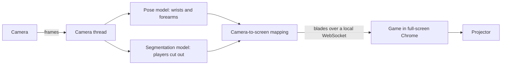

# Interactive Projector Camera Game

[](https://github.com/Puddin1066/InteractiveProjector-CameraGame/actions/workflows/haunted-wall-smoke.yml)
[](LICENSE)
[](https://www.python.org)

Party games you play with your hands on a wall. A projector throws the game
onto a wall, a camera watches the players, and a pose model turns their hands
into blades and pointers: no controllers, no touch screen. It started as a
balloon-popping game and now includes a set of Lincoln Lynx Halloween games
for groups of kids, such as **Midnight Slash**, a Fruit Ninja-style game for
up to five players at once.


## What this solves

Turning a blank wall into a game usually takes special hardware, such as depth
cameras, touch foils or controllers. This project needs only what most people
already have: a laptop, any camera (the built-in one, a USB webcam, an iPhone
through Continuity Camera, or an RTSP security camera) and a projector or big
screen. One launcher starts every game and remembers your camera and
projector.

## Who it is for

- Parents, teachers and party hosts who want a big-screen game kids play with
  their whole bodies, for example at a school Halloween night.
- Tinkerers learning computer vision: camera-to-projector calibration, pose
  and segmentation models, and keeping a game smooth with threads.

## Why it matters

Five kids can play together in front of one wall, take three-minute turns and
hand over to the next group. Nobody has to hold or share a device, and the
setup packs into a backpack.

## Games

| Command | Game | How you play |
|---|---|---|
| `python3 play.py midnight-slash` | Midnight Slash | Spookier Spooky Slash: 3-minute team rounds that speed up, "Witching Hour" bursts, a witch-hat Lynx mascot |
| `python3 play.py spooky-slash` | Spooky Slash | Fruit Ninja on the wall, sliced by up to five kids' hands; the players appear cut out inside the scene |
| `python3 play.py pumpkin-slash` | Pumpkin Slash | Two teams slice pumpkins; the camera faces the players |
| `python3 play.py pong` | Halloween Pong | Raise a hand on your half of the wall to move your paddle |
| `python3 play.py haunted-wall` | Haunted Wall | Tag the ghosts drifting across the wall ([details](HAUNTED_WALL.md)) |
| `python3 play.py balloon-pop` | Balloon Pop | The original game: point at balloons to pop them before time runs out |

## How it works



- **Camera facing the players** (default for the slash games): the camera sits
  by the wall and looks at the kids, who play a few steps back, out of the
  projector's beam. No calibration is needed, and the game shows the players
  mirrored inside the scene.
- **Camera facing the wall**: the camera watches the projected picture from
  behind the players. The game projects markers so the camera can find the
  picture's corners; press C to calibrate again.
- Spooky Slash and Midnight Slash run in Chrome: a small Python server
  (`modules/web_game_server.py`) serves the page and sends it blades. A theme
  folder can sit over a base game, so `web/midnight_slash` holds only what
  differs from `web/spooky_slash`.
- The pygame games (Balloon Pop, Pong, Pumpkin Slash, Haunted Wall) draw
  straight to the projector and split camera, detection, game and audio across
  threads ([README_THREADING.md](README_THREADING.md)).

## Quick start

You need Python 3.11 or newer, a camera, a projector or second screen, and
Google Chrome for the slash games. Development happens on macOS on Apple
silicon; the pygame games also run on Windows and Linux.

```bash
git clone https://github.com/Puddin1066/InteractiveProjector-CameraGame.git
cd InteractiveProjector-CameraGame
python3 -m venv .venv
.venv/bin/pip install -r requirements.txt
python3 play.py                                        # list the games
python3 play.py midnight-slash --camera 1 --projector 1
```

The camera and projector numbers are remembered in `.env`, so after the first
time `python3 play.py midnight-slash` is enough. The models download on first
run into `models/`.

## Commands

```bash
python3 play.py                       # list the games
python3 play.py <game> [options]      # start one; options after the name go to the game
python3 -m tools.camera_probe         # list cameras (0 is a Mac's built-in camera; an iPhone is usually 1)
python3 play.py spooky-slash --debug  # also save what the camera sees, with the blades drawn on
python3 -m tools.make_midnight_slash_art     # rebuild Midnight Slash's images from art/midnight_slash
python3 -m tools.make_midnight_slash_sounds  # download and encode its music and voices (needs ffmpeg)
python3 -m tools.prepare_halloween_assets    # download Haunted Wall's CC0 art
```

Spooky Slash and Midnight Slash take `--layout players|wall`,
`--blades hands|shadows` (shadows need `--layout wall`) and `--debug`. Press
Ctrl+C in the terminal to quit.

## Configuration

Settings come from `.env` (copy [.env.example](.env.example)) or the
environment; defaults live in `modules/config.py`.

| Setting | Meaning |
|---|---|
| `CAMERA_INDEX` | Which camera to use (see `tools.camera_probe`) |
| `PROJECTOR_MONITOR_INDEX` | Which screen is the projector (usually 1 on a laptop) |
| `CAMERA_FACING` | `players` or `wall`: the default layout for the slash games |
| `SENSOR_MODE`, `REOLINK_RTSP_URL` | Use an RTSP security camera instead ([IPHONE_SENSOR.md](IPHONE_SENSOR.md), [HAUNTED_WALL.md](HAUNTED_WALL.md)) |
| `CAMERA_WIDTH`, `CAMERA_HEIGHT`, `CAMERA_FPS` | Capture size and rate |

Keep real camera passwords in `.env` only; it is git-ignored.

## Testing

```bash
python3 -m compileall -q play.py games modules tools tests datapreprocessing
python3 tests/smoke_test_haunted_wall.py           # Haunted Wall entry points parse
.venv/bin/python tests/test_threading.py           # thread-safe game state
.venv/bin/python tests/mock_test_midnight_slash.py # MOCK: scripted swipes in headless Chrome
```

The Midnight Slash test is a mock: no camera or projector. The real game
server serves the page to headless Chrome, scripted swipes stand in for hands,
and the game clock runs ten times faster. It plays a whole round and saves
screenshots to the system's temporary folder. CI runs the compile and smoke
checks on every pull request. Anything that changes what the camera sees still
needs a try with a real camera and projector.

## Balloon Pop, the original game

Players pop projected balloons by pointing at them within a 120-second round,
while the sky turns from day to night. Calibrate by clicking the four corners
of the projected picture in the camera view.

| Key | Action |
|---|---|
| C | Calibrate the camera again |
| D | Show or hide the debug overlay |
| R | Restart (on the game-over screen) |
| Q or Esc | Quit |

The mouse pops balloons too, for testing. Its four-thread design is described
in [README_THREADING.md](README_THREADING.md):


## Troubleshooting

- **Wrong camera, or no picture**: run `python3 -m tools.camera_probe`, then
  start the game with `--camera N`. On macOS, allow camera access for your
  terminal in System Settings > Privacy & Security > Camera.
- **The game opens on the laptop screen**: pass `--projector N` (0 is the
  laptop's own screen).
- **Slashes miss**: check that the players' hands stay inside the camera view
  and the room is lit. `--debug` saves frames showing what the camera sees.
- **Calibration fails (wall layout)**: make sure the camera sees the whole
  projected picture, then press C to try again.
- **The game feels laggy**: a wired camera has less delay than a wireless one;
  close other apps that use the GPU.

## Project layout

```text
play.py              launcher: python3 play.py <game>
games/               one file per game
modules/             shared code: camera, models, calibration, screen mapping, game server
web/spooky_slash/    Spooky Slash's browser game (a reskinned Fruit Ninja HTML5 engine)
web/midnight_slash/  Midnight Slash: only the art, sounds and rules that differ from Spooky Slash
art/midnight_slash/  source paintings for Midnight Slash's images
assets/              Balloon Pop images and sounds
tools/               camera probe, diagnostics, art and sound builders
tests/               smoke, threading and mock tests
datapreprocessing/   training-data tools for the balloon game's detector
legacy/              old prototypes, kept for reference
```

## Status and releases

Active hobby project, run from source: there are no packaged releases or
versions, and `main` is always the version to use. Changes arrive through pull
requests.

## Contributing, support and security

- [CONTRIBUTING.md](CONTRIBUTING.md): setup, checks and how to add a game.
- [SUPPORT.md](SUPPORT.md): where to ask for help or suggest a game.
- [SECURITY.md](SECURITY.md): report security problems privately.
- [CODE_OF_CONDUCT.md](CODE_OF_CONDUCT.md): Contributor Covenant 2.1.

## License

This project's own code and art are under the [MIT license](LICENSE). Some
parts come from others and keep their own terms; see
[THIRD_PARTY_NOTICES.md](THIRD_PARTY_NOTICES.md). Notably, the Fruit Ninja
engine under `web/spooky_slash` has no upstream license and is not covered by
MIT, and Ultralytics YOLO, installed as a dependency, is AGPL-3.0.

## Authors

- **Jiten Rai** ([@Jitenrai21](https://github.com/Jitenrai21)): the original
  Balloon Pop game and its threaded architecture
  ([original repository](https://github.com/Jitenrai21/InteractiveProjector-CameraGame)).
- **John Round** ([@Puddin1066](https://github.com/Puddin1066)): the
  Halloween games, the launcher and camera-facing play.

Thanks to Ultralytics, OpenCV, pygame, MediaPipe and the Baidu JS team's
Fruit Ninja.
